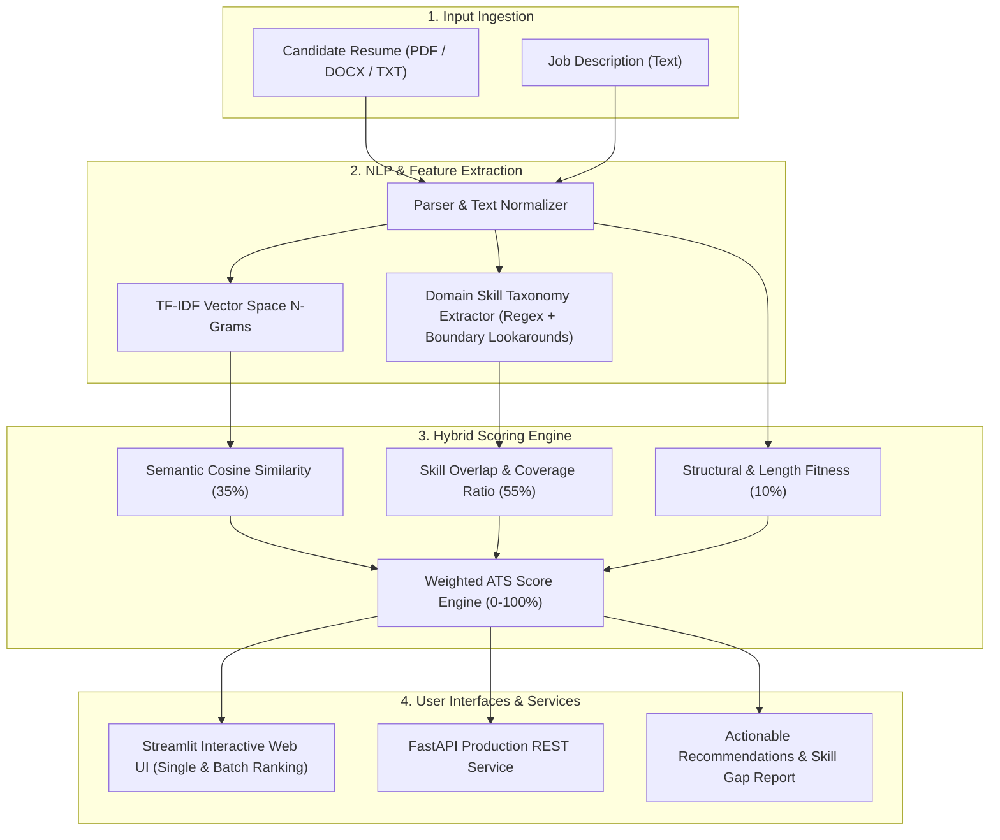

# 🎯 Smart ATS Resume Matcher & Candidate Screening AI

[](https://www.python.org/downloads/)
[](https://fastapi.tiangolo.com)
[](https://streamlit.io)
[](https://scikit-learn.org/)
[](https://opensource.org/licenses/MIT)

An end-to-end Machine Learning and Natural Language Processing (NLP) Applicant Tracking System (ATS) that evaluates candidate resumes against job descriptions, computes semantic TF-IDF relevance, extracts technical skill taxonomies, calculates candidate-job alignment scores, and performs automated gap analysis.

---

## 📌 Architecture & Workflow



---

## ✨ Key Features

- **Multi-Format Resume Parsing:** Seamlessly parses and normalizes plain text, `.pdf` (via `pypdf`), and `.docx` (via `python-docx`).
- **Domain-Specific Skill Taxonomy:** Boundary-aware regex extraction covering 100+ technologies across Machine Learning, Programming Languages, Web Frameworks, Cloud, DevOps, and Databases.
- **Hybrid Scoring Engine:** Blends semantic content cosine similarity (TF-IDF sublinear scaling) with categorical skill requirement matching and document length fitness.
- **Automated Skill Gap Analysis:** Highlights exact matched skills, missing required skills, and extra candidate competencies.
- **Actionable ATS Suggestions:** Delivers intelligent recommendations to help candidates optimize resumes for ATS filter passing.
- **Batch Candidate Leaderboard:** Enables recruiters to upload multiple resumes simultaneously and rank them against a target job specification.
- **Dual Interface:**
  - **Streamlit Web Dashboard** for human interactive screening and exploratory analysis.
  - **FastAPI REST API** with Pydantic validation for enterprise backend integration.

---

## 📁 Project Structure

```text
smart-ats-resume-matcher/
├── api/
│   ├── __init__.py
│   └── main.py                    # FastAPI REST API endpoints
├── data/
│   ├── sample_jobs/               # Sample job descriptions (ML Engineer, Fullstack)
│   ├── sample_resumes/            # Sample test resumes (ML, Frontend, Data Analyst)
│   └── skills_taxonomy.json       # Configurable skills dictionary
├── src/
│   ├── __init__.py
│   ├── matcher.py                 # TF-IDF similarity & weighted ATS scoring logic
│   ├── parser.py                  # Text extraction from PDF, DOCX, TXT
│   ├── report.py                  # Executive summary and recommendation generator
│   └── skills_extractor.py        # Taxonomy-driven entity extractor
├── tests/
│   ├── __init__.py
│   ├── test_matcher.py
│   ├── test_parser.py
│   └── test_skills_extractor.py
├── app.py                         # Streamlit interactive web dashboard
├── requirements.txt               # Project dependencies
├── .gitignore
└── README.md
```

---

## 🚀 Quickstart Guide

### 1. Clone & Set Up Environment

```bash
git clone https://github.com/imsalmanali/smart-ats-resume-matcher.git
cd smart-ats-resume-matcher

# Create and activate virtual environment
python -m venv .venv

# Windows:
.\.venv\Scripts\activate

# macOS / Linux:
source .venv/bin/activate

# Install dependencies
pip install -r requirements.txt
```

---

### 2. Launch the Streamlit Web Application

```bash
streamlit run app.py
```
Open your browser at `http://localhost:8501` to test single match evaluations, batch candidate screening, and the skill taxonomy explorer.

---

### 3. Launch the FastAPI REST Server

```bash
uvicorn api.main:app --reload --port 8000
```
- Interactive Swagger API docs: `http://localhost:8000/docs`
- Redoc documentation: `http://localhost:8000/redoc`

#### API Sample Request (`POST /api/v1/match`):

```bash
curl -X POST "http://localhost:8000/api/v1/match" \
  -H "Content-Type: application/json" \
  -d '{
    "candidate_name": "Alex Rivera",
    "resume_text": "Experienced Machine Learning Engineer with Python, PyTorch, Scikit-Learn, Docker and AWS.",
    "job_description": "Seeking ML Engineer with strong Python, PyTorch, Docker, Kubernetes and AWS experience."
  }'
```

#### API Sample Response:

```json
{
  "candidate_name": "Alex Rivera",
  "overall_score": 83.2,
  "match_tier": "High Match",
  "status_color": "green",
  "breakdown": {
    "skill_coverage_score": 80.0,
    "semantic_similarity_score": 85.5,
    "structure_score": 100.0,
    "word_count": 480
  },
  "skill_analysis": {
    "matched_skills": ["AWS", "Docker", "PyTorch", "Python"],
    "missing_skills": ["Kubernetes"],
    "extra_skills": ["Scikit-Learn"],
    "matched_count": 4,
    "total_required": 5,
    "coverage_ratio": 0.8
  },
  "recommendations": [
    "Add missing required skills: Consider highlighting experience with Kubernetes in your projects or summary."
  ]
}
```

---

## 🧪 Running Unit Tests

Run the full automated test suite using Python's built-in `unittest`:

```bash
python -m unittest discover tests
```

Or with `pytest`:

```bash
pytest -v
```

---

## 👤 Author

- **Salman Ali** - [GitHub: @imsalmanali](https://github.com/imsalmanali)

## 📄 License

This project is licensed under the MIT License.
